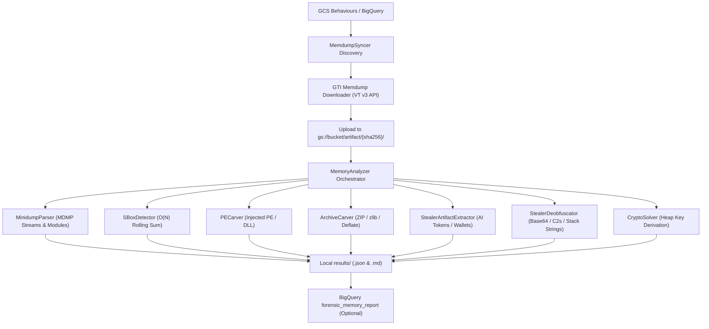

# Kinetic MemHunter (`kinetic-memhunter`)

> **Kinetic Memory & Cryptographic State Hunter for Process Memory Dumps**

`kinetic-memhunter` is a high-performance in-memory digital forensics and threat extraction engine designed to analyze process memory dumps (`.dmp`, `.raw`, `.bin`) and extract active cryptographic primitives, unmapped/reflective PE binaries, staged exfiltration archives, and harvested developer credentials.

---

## Capabilities & Architecture



### Forensic Engines
1. **Windows Minidump Parser (`MinidumpParser`)**:
   - Parses native Windows Minidump format (`MDMP`, `0x504D444D`).
   - Extracts memory ranges from `MemoryListStream` (type 5) and `Memory64ListStream` (type 9).
   - Maps loaded modules and DLLs directly from `ModuleListStream` (type 4).
2. **Kinetic Cryptographic S-Box Detector (`SBoxDetector`)**:
   - **RC4 KSA S-Box**: $O(N)$ rolling-sum sliding window ($\sum S[i] = 32640$, 256 unique bytes, Shannon entropy $= 8.0$, non-identity check).
   - **Rijndael AES Tables**: Forward and Inverse S-Box tables.
   - **ChaCha20 / Salsa20**: Constant sigma/tau rotation markers (`"expand 32-byte k"`, `"expand 16-byte k"`).
3. **In-Memory Executable PE Carver (`PECarver`)**:
   - Scans unmapped memory and virtual process heaps for `MZ` / `PE\x00\x00`.
   - Identifies reflective loaders and injected DLLs by contrasting `VirtualAddress` vs `PointerToRawData`.
   - Identifies suspicious stealer imports (`CryptUnprotectData`, `sqlite3_open`, `InternetOpenA`).
4. **In-Memory Archive Carver (`ArchiveCarver`)**:
   - Carves ZIP archives (`PK\x03\x04`) and raw zlib streams in RAM.
   - Scans decompressed payload contents for stealer artifacts (`passwords.txt`, `cookies.sqlite`, `wallet.dat`).
5. **Stealer Credential & Session Extractor (`StealerArtifactExtractor`)**:
   - **AI Developer Sessions**: Anthropic Claude (`sk-ant-sid01-`, `sessionKey=`), OpenAI ChatGPT (`sk-proj-`, `sess-`), Google Gemini (`__Secure-1PSID`, `AIzaSy`), Hugging Face (`hf_`).
   - **Browser DPAPI / Master Keys**: DPAPI blob headers and Chrome/Edge AES-GCM `v10` master key structures.
   - **Crypto Wallets**: MetaMask, Phantom, Coinbase Wallet, and TronLink extension IDs and seeds.
   - **Cloud Secrets**: AWS Access Keys (`AKIA*`) and GitHub tokens.
6. **Stealer Deobfuscator & Infrastructure Hunter (`StealerDeobfuscator`)**:
   - In-memory Base64 payload decoding (unveiling embedded C2 configurations and queries).
   - Plaintext & deobfuscated C2 endpoint discovery (`.onion`, HTTP/HTTPS gates).
   - Exfiltration exit discovery (Telegram bot tokens, Discord webhooks).
   - Targeted browser profile reconnaissance (`AppData\Local\Google\Chrome\User Data`, `moz_cookies`, `logins`).
7. **MITRE ATT&CK Mapping & Threat Scoring**:
   - Automatically attributes techniques **T1027**, **T1055**, **T1071**, **T1539**, **T1552**, **T1555**, **T1560**, and **T1567**.

---

## Installation & CLI Usage

### 1. Single File Analysis

```bash
python -m kinetic_memhunter.cli analyze /path/to/memory_dump.dmp \
    --json results/report.json \
    --markdown results/report.md
```

### 2. Batch GTI Synchronization & Analysis

Downloads memdumps for all sandbox reports with memdumps from the VirusTotal / GTI API, saves the raw ZIPs in GCS under `gs://<bucket>/artifact/{sha256}/`, analyzes all process `.dmp` files, and saves structured reports in `results/`:

```bash
# Sync and analyze 10 sandbox dumps with 4 workers:
python -m kinetic_memhunter.cli sync-and-analyze --limit 10 --workers 4

# Sync, analyze, and publish to BigQuery:
python -m kinetic_memhunter.cli sync-and-analyze --workers 4 --publish-bigquery
```

### 3. Python API

```python
from kinetic_memhunter import MemoryAnalyzer

analyzer = MemoryAnalyzer()
report = analyzer.analyze_file("5856.dmp")

print(f"Verdict: {report.threat_verdict} (Score: {report.threat_score}/100)")
for cred in report.credentials:
    print(f"Staged {cred.platform}: {cred.match_value}")
for prim in report.crypto_primitives:
    print(f"Active cipher state: {prim.primitive} at offset 0x{prim.offset:X}")
for c2 in report.c2_urls:
    print(f"Discovered C2: {c2}")
```

---

## Results Directory Structure

All batch analysis results are written to `kinetic-memhunter/results/`:
- `<sha256>_<sandbox>_<dump_name>.json`: Full forensic telemetry and extracted artifacts.
- `<sha256>_<sandbox>_<dump_name>.md`: Human-readable markdown forensic report.
- `CONSOLIDATED_FORENSIC_REPORT.md`: Executive summary with aggregate statistics and notable findings.
- `summary.json`: High-level counters across all analyzed memory dumps.
