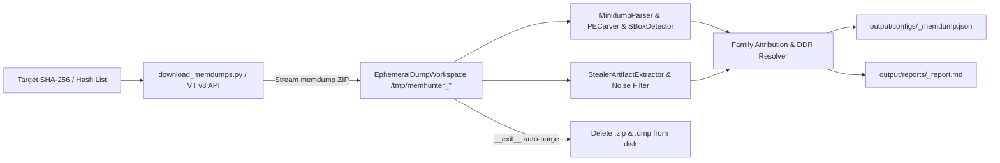

# Software Design Document (SDD) — `memhunter`

## 1. System Overview
`memhunter` is a stateless, headless memory forensics and RAM carving microservice designed to extract decrypted C2 configurations, exfiltration webhooks, clipper wallets, DPAPI master keys, and Dead Drop Resolvers (DDRs) from sandbox process memory dumps (`.dmp` inside VirusTotal v3 behaviour `.zip` archives).

---

## 2. Domain Architecture

| Module | Responsibility | Line Budget |
| :--- | :--- | :--- |
| `memhunter/config.py` | Environment configuration, OID/version/sandbox URL blocklists, and carving bounds. | `< 150` |
| `memhunter/workspace.py` | `EphemeralDumpWorkspace` context manager, Zip-Slip defense, Zip-Bomb guard, and guaranteed `.zip`/`.dmp` cleanup. | `< 150` |
| `memhunter/downloader.py` | VirusTotal v3 `/files/{sha256}/behaviours` inspection and `/file_behaviours/{sandbox_id}/memdump` streaming download. | `< 200` |
| `memhunter/carvers/minidump.py` | Windows Minidump (`MDMP`) stream parser, reflective PE/CLR carver (`MZ`/`BSJB`), and crypto S-Box detector (`RC4`/`AES`/`ChaCha20`). | `< 250` |
| `memhunter/carvers/artifacts.py` | Plaintext C2 JSON config carver (Lumma/Stealc/Raccoon), Discord/Telegram extractor, ETH/BTC wallet validator, DDR resolver, SQLite/Chromium `v10`/`v20` detector, and `family_supposition` classifier. | `< 300` |
| `memhunter/reporting.py` | `service_memdump`-compatible JSON serializer, `reverserk-ai` `memdump_analysis.json` exporter, and Markdown report builder. | `< 200` |
| `memhunter/service.py` | Stateless orchestrator connecting download -> carve -> delete -> report persistence. | `< 200` |
| `download_memdumps.py` | Standalone, single-file portable CLI script to download VT memdumps on any machine. | `< 250` |
| `analyze_memdumps.py` | Main CLI orchestrator for single-sample or batch ephemeral memory carving. | `< 150` |

---

## 3. Output Schema Contract (`output/configs/<sha256>_memdump.json`)

Emits a superset compatible with both `stealers_analysis.service_memdump` and `reverserk-ai`'s `memdump_analysis.json`:
- `hash` / `sha256`: Sample SHA-256 digest.
- `family_supposition`: Attributed malware family (e.g., `pulsar_rat`, `dcrat`, `raton_rat`, `lumma_stealer`, `stealc`, `redline_stealer`).
- `sandbox_sources`: List of sandbox IDs analyzed (e.g., `CAPE Sandbox`, `Zenbox`).
- `minidump_summary`: Parsed `MDMP` streams, loaded modules, reflective PEs, and `.NET` CLR assemblies in RAM.
- `crypto_intel`: Detected `RC4`, `AES`, and `ChaCha20` S-Boxes and `chromium_master_keys`.
- `extracted_c2`: Filtered `ips_urls`, `webhooks` (Discord/Telegram), `crypto_wallets` (ETH/BTC), `ddr` (with live resolution when available), and `ftp_activity`.
- `behaviour_intel`: `extracted_c2_json_config` (decrypted Lumma/Stealc JSON configs), `malware_targets`, `mutexes`, `pdb_paths`.
- `sqlite_database`: Carved SQLite3 headers and table schemas in memory.
- `in_memory_strings`: High-signal deobfuscated strings for `reverserk-ai` fusion.
